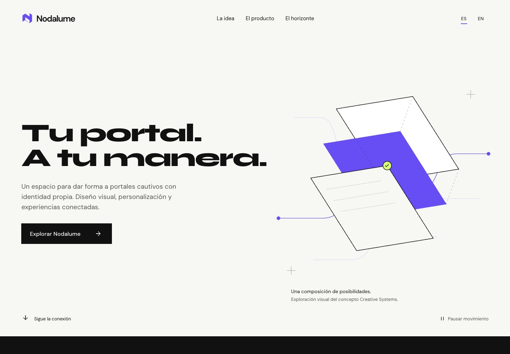
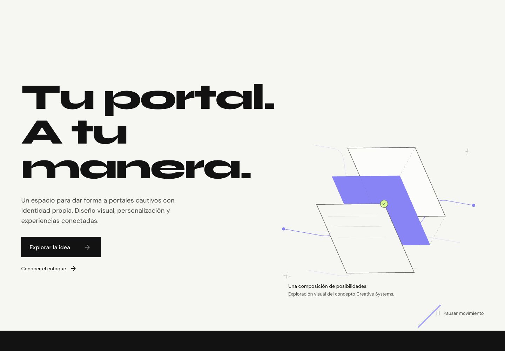
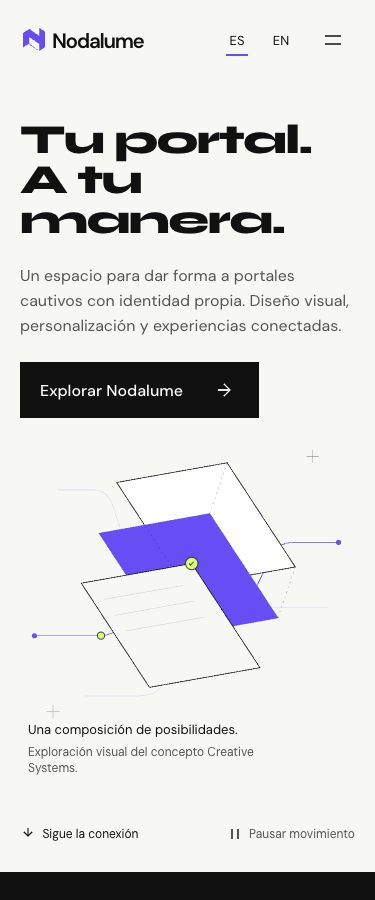
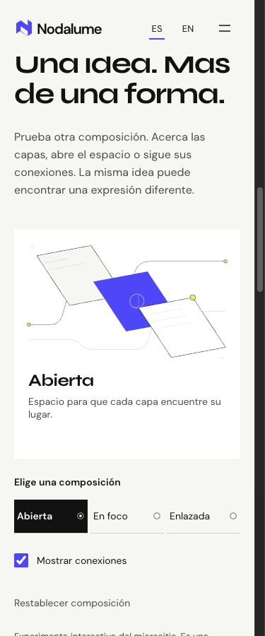
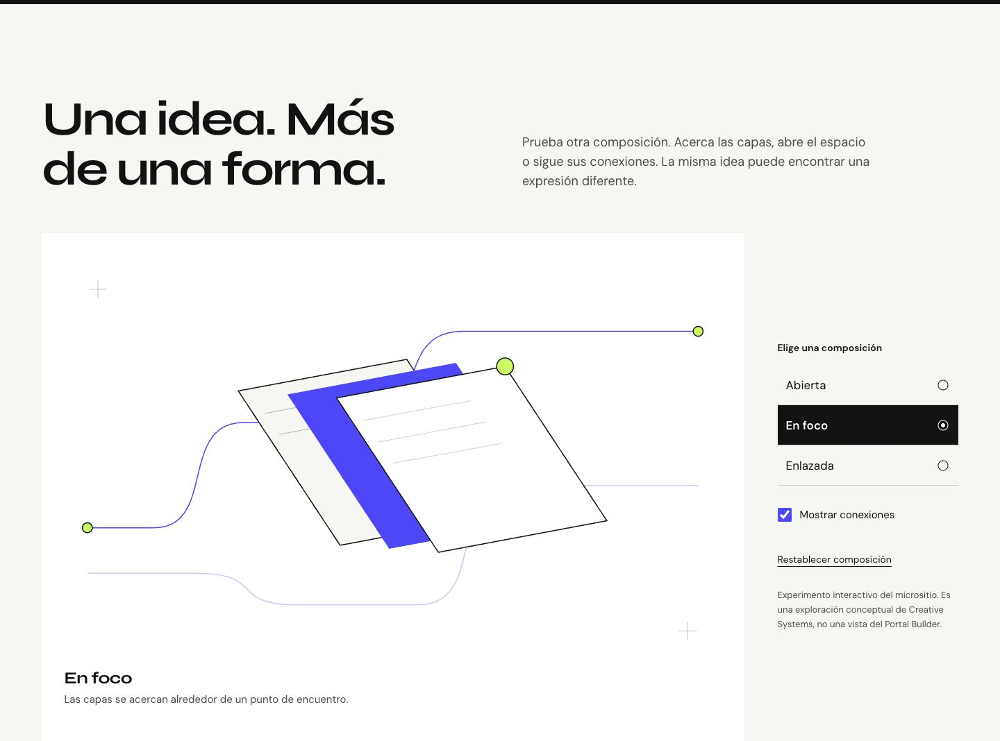
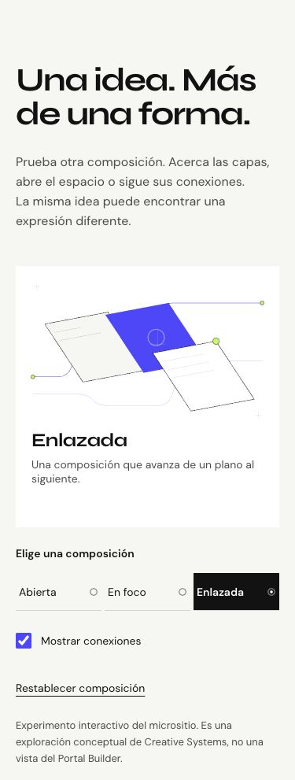

# NDL-WEB-002 — separación, publicación y evolución creativa

Trabajo del 27–28 de octubre de 2026. **GO de la publicación inicial NDL-WEB-001. GO para revisión local de NDL-WEB-002; su publicación no está autorizada ni se ha ejecutado.**

## A. Repositorio independiente

[Zuriel0/nodalume-web](https://github.com/Zuriel0/nodalume-web), carpeta local `/Users/zury/Documentos/nodalume-web`. La raíz contiene directamente package.json/lock, Vite, ESLint, src, public, tests, scripts, docs, DESIGN, PRODUCT y README. No hay un prefijo microsites/nodalume ni dependencia del panel administrativo o ANXZU.

| Referencia                    | SHA                                        |
| ----------------------------- | ------------------------------------------ |
| Fuente NDL-WEB-001 en ANXZU   | `a5c396a5aef4cb9fb005828f7b00f596a20e8d0c` |
| Árbol original del micrositio | `faa0addb2dcfc408c05ed2edc39f8429bb7dab5f` |
| Commit inicial de migración   | `d4caa3b0881189ab4c4ccc641ef25c8a14d3e745` |
| main publicado                | `d4f833004cba3c24aa4a252fa075d6fca250617f` |
| Commit de evolución local     | `de5eacaa17fc5853f7d58ef3dcb505e8feb7ca3c` |

Se comprobó que el repositorio no existía antes de crearlo. Se migraron exactamente 62 archivos rastreados; el árbol del commit inicial coincide byte por byte con el subtree original. [Inventario y hashes](migration/ndl-web-001-inventory.json). Se conservaron un backup branch y un Git bundle local verificado antes de modificar la fuente. No se copiaron dependencias, dist, secretos, auth state, cookies, temporales de navegador o videos. Las licencias OFL y el isotipo original se conservan.

La configuración de publicación añade únicamente infraestructura y documentación al baseline validado. `base: '/'`, Node 24 y lockfile propio. Antes del push de publicación pasaron npm ci, lint, tests, build y diff check. No se mezcló ningún refinamiento visual en esa primera publicación.

El workflow `.github/workflows/deploy.yml` utiliza checkout 7.0.1, setup-node 7.1.0, configure-pages 6.0.0, upload-pages-artifact 5.0.0 y deploy-pages 5.0.1, fijados por SHA tras consultar sus releases oficiales. [Pins](migration/actions.json). Ejecuta las comprobaciones y sube exclusivamente dist. Build tiene contents:read; deploy pages:write/id-token:write. La concurrencia evita despliegues simultáneos y ambos jobs rechazan refs distintas de main, incluso en ejecución manual.

## B. Dominio y publicación verificada

**URL pública: https://nodalume.anxzu.com/**. Sigue sirviendo NDL-WEB-001, commit main `d4f8330`.

- CNAME comprobado con el resolver del sistema y 1.1.1.1: `Zuriel0.github.io.`; no contiene nombre de repositorio.
- Dominio configurado mediante los ajustes/API de Pages, fuente `workflow`; no depende de CNAME dentro de dist.
- Certificado aprobado por Pages y validado con CA/hostname desde el cliente, sin omitir verificación. NotAfter observado: **2027-01-26 02:54:10 UTC**; certificado/fingerprint en la evidencia.
- Enforce HTTPS activo; HTTP devuelve 301 a HTTPS. El diagnóstico final de GitHub confirma DNS válido, sitio servido por Pages, HTTPS válido y sin error TLS.
- [Workflow 40629182568](https://github.com/Zuriel0/nodalume-web/actions/runs/40629182568): build y deploy success para el SHA publicado.
- HTML y los diez recursos públicos coinciden con el build de referencia. Se verificaron fuentes, marca, CSS, JS, movimiento, pausa, EN/ES, persistencia, menú, anclas y consola.
- Lighthouse público adicional comprobó reduced motion sin chunk GSAP. Sus mediciones se conservan separadas de la comparación local.

[Verificación pública final](evidence/ndl-web-002/publication/final-public-verification.json), [Pages](evidence/ndl-web-002/publication/pages-final.json), [health final](evidence/ndl-web-002/publication/pages-health-final.json), [workflow](evidence/ndl-web-002/publication/workflow.json), [QA público](evidence/ndl-web-002/publication/public-functional.json).

No se modificó ningún registro DNS, incluido anxzu.com/www. No hubo conflicto de dominio. El GO se determinó después de verificar el dominio real, no solo por el workflow.

## C. Separación e integración de ANXZU

Repositorio fuente: [communications-electronics-portfolio](https://github.com/Zuriel0/communications-electronics-portfolio). Inicio: `codex/ndl-web-001-creative-systems` en `a5c396a`; final: `main` en **`1ccd9e8d694052eb3191282e7794afa640e47895`**, push normal confirmado.

Solo después de verificar la migración y el sitio público se retiraron los 62 archivos del micrositio, sus carpetas generadas locales y la exclusión de ESLint que existía para alojarlo. El commit de documentación pendiente `6766c58` se integró conservando la historia; no hubo conflictos ni cambios ajenos de código. La integración a main fue fast-forward, sin force push, reescrituras de commits o tags.

Backup: branch `codex/backup-ndl-web-001-20261027` en `a5c396a`, más bundle local verificado. Los archivos del micrositio siguen recuperables en la historia.

| Validación oficial ANXZU              | Resultado                                                       |
| ------------------------------------- | --------------------------------------------------------------- |
| npm ci                                | Correcto                                                        |
| npm run lint                          | Correcto                                                        |
| npm run build -- --manifest           | Correcto                                                        |
| node --test tests/*.test.js           | 53/53, cero fallos                                              |
| node scripts/check-project-chunks.mjs | Correcto; home excluye React Flow y diagramas conservan runtime |
| git diff --check                      | Correcto                                                        |
| npm audit                             | Cero vulnerabilidades                                           |

Un export de v1.2.1 compilado con el mismo toolchain produjo **53 archivos idénticos** al build posterior a la separación. Se distingue tag object `67bc1d0…` del commit al que apunta, `a2a6b1e…`. [Comparación completa](evidence/ndl-web-002/publication/anxzu-build-comparison.json).

**Zuriel0/page permanece en `a256bf8cf9805fdf7db912d0d7816adedd247e6b`.** No se modificó ni desplegó ese repositorio, ni se creó release ANXZU. Home y el caso Nodalume conservan los hashes HTML públicos previos. El enlace https://anxzu.com/projects/nodalume/ sigue operativo y fue visitado desde la revisión local. Home, Concurrencia, Metodología, Nodalume Engineering, credenciales, Hero, traducciones, SEO, capacidades y diagramas mantienen su implementación v1.2.1.

Evidencia fuente también en [reporte de separación ANXZU](https://github.com/Zuriel0/communications-electronics-portfolio/blob/main/docs/redesign/nodalume-web-separation.md).

## D. Evolución NDL-WEB-002, solo local

Rama **`codex/ndl-web-002-creative-evolution`**, sin push ni merge. Preview: **http://127.0.0.1:4186/**. main conserva el baseline publicado.

La [auditoría previa](ndl-web-002-visual-audit.md) inspeccionó el sitio público a 1440/375 antes de editar. Se conservaron Creative Systems, Syne/DM Sans, blanco cálido, negro, Electric, Signal y geometría de marca. Se aplicaron las cuatro skills revisadas sin instalar motores o hooks innecesarios.

Cambios:

- Hero con las mismas palabras, tres líneas y mayor escala editorial; profundidad mediante capas y perspectiva limitada, señal con entrada/salida suave.
- Pliegue que relaciona blanco y negro durante scroll nativo; narrativa tipográfica/conector coordinados, sin pinning.
- Primera Living Interface: tres composiciones, mostrar/ocultar conexiones y reset. React/CSS modifica solo un SVG conceptual local; no es una vista del Portal Builder ni ejecuta flujos del producto.
- Nav sticky con compensación de foco/anclas; microinteracciones CSS coherentes en flechas, menú y pausa.
- Enlace al caso real de ingeniería ANXZU; frame de video pendiente conservado. No se integra material privado ni se genera una UI ficticia.

[Design system](../DESIGN.md), [catálogo de motion](motion-catalog.md), [mapa](experience-map.md), [assets](asset-inventory.md), [skills](skills-review.md), [revisión de acabado](ndl-web-002-review.md).

### Evidencia antes/después

Hay capturas EN/ES de 320, 375, 768, 1024, 1440 y 1920, más página completa y [menú móvil](evidence/ndl-web-002/after/menu-375.jpg). [Responsive](evidence/ndl-web-002/after/responsive.json), [interacción y estado](evidence/ndl-web-002/after/functional.json), [teclado/movimiento/cleanup](evidence/ndl-web-002/after/final-motion-keyboard.json), [fallback](evidence/ndl-web-002/after/fallback.json) y [enlace/consola](evidence/ndl-web-002/after/engineering-link-console.json).

### QA y métricas

Lint, tests existentes, build y diff check correctos; npm audit final del micrositio también reporta cero vulnerabilidades. En las doce combinaciones no hay texto fuera de viewport, IDs duplicados u overflow; fuentes confirmadas. Se probaron teclado, foco, menú, presets, conexiones, reset, persistencia y estado entre idiomas, pausa y reanudación. El Studio funciona aun pausado y tras un fallo 503 exclusivo del chunk. Tres ciclos conservaron **6 → 0 → 6 triggers**, sin acumulación; el ambiental se pausa fuera de vista. Consola normal sin errores o warnings.

Comparación de builds estables, misma configuración, tres corridas por perfil/versión:

| Perfil     | P/A baseline y candidato  | LCP mediana baseline → candidato | CLS        | TBT           |
| ---------- | ------------------------- | -------------------------------- | ---------- | ------------- |
| Móvil      | 100/100 en las 6 corridas | 752.6 → 752.9 ms                 | 0 en todas | 0 ms en todas |
| Escritorio | 100/100 en las 6 corridas | 202.5 → 203.9 ms                 | 0 en todas | 0 ms en todas |

No se afirma una mejora de velocidad: los rangos se solapan. Entry: **238,308 → 244,784 bytes**; motion: **116,097 → 117,261**; CSS: **13,787 → 19,925**. JS total normal: **354,405 → 362,045 bytes**. No hay dependencias nuevas. Reduced motion evita el chunk GSAP, deja cero triggers y transiciones del Studio a 0s. [Método, rangos y evidencia](ndl-web-002-performance.md).

Archivos de implementación: `src/App.jsx`, `src/content.js`, `src/motion.js`, `src/styles.css`, nuevo `src/components/LivingInterface.jsx` y auditor parametrizado `scripts/audit.mjs`. Se actualiza documentación de diseño, assets, navegación y motion. Package/lock, archivos de marca/fuentes y workflow no cambian en la rama de evolución.

## E. Riesgos, límites y decisión

**GO para revisión del propietario; no publicación automática de NDL-WEB-002.** El baseline público permanece verificable y separado de la rama de diseño. No se han creado tags/releases ni nuevas grabaciones.

Pendientes explícitos:

- Verificar hidden/visible en navegador convencional: IAB mantiene documentos visibles al cambiar de pestaña. La suspensión y recuperación está implementada y revisada, pero no se declara probado ese evento real.
- Hardware táctil, otros motores, lector de pantalla real, CPU/FPS, movimiento al 10% y sesiones prolongadas no se midieron. Viewports y objetivos táctiles se validaron; no equivalen a hardware físico.
- El fallback comprobado cubre fallo de animación; la app React sigue necesitando JavaScript.
- El medio audiovisual real continúa pendiente de autorización y revisión de marcas/datos. No se reutiliza el video privado ANX-014.
- El baseline conserva noindex como decisión de revisión de producto; no es un control de acceso. La indexación se decide separadamente.
- Mantener la distinción entre implementación, desarrollo parcial, concepto y futuro. La interacción nueva no constituye evidencia de funciones del producto operativo.

Recomendación: revisar el Hero y el Studio local, completar la comprobación manual de visibilidad/hardware y decidir el siguiente paso audiovisual con material autorizado. Cualquier merge o publicación del refinamiento requiere una autorización posterior. Backend, consola, RADIUS, Docker y proyectos demo no se modificaron.
