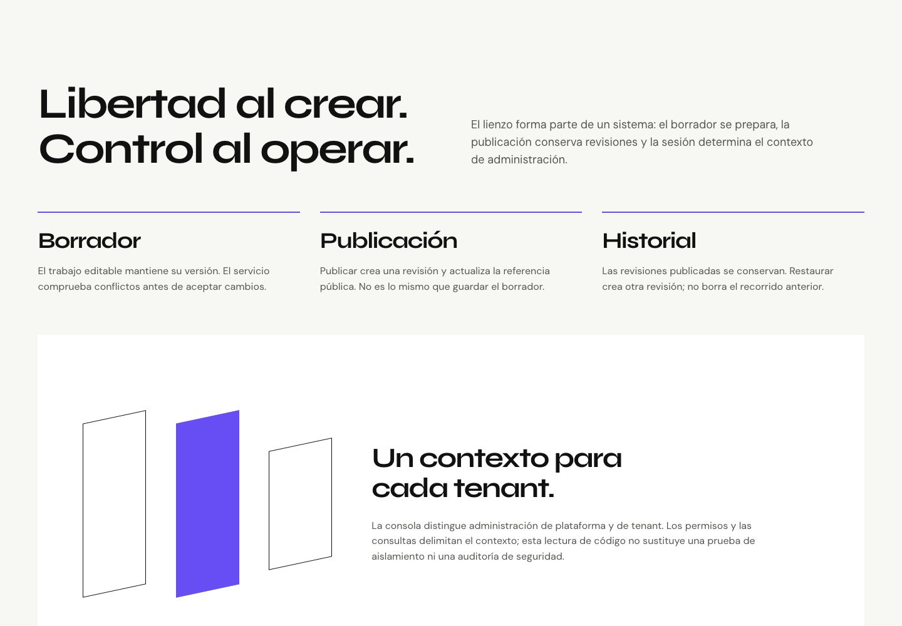
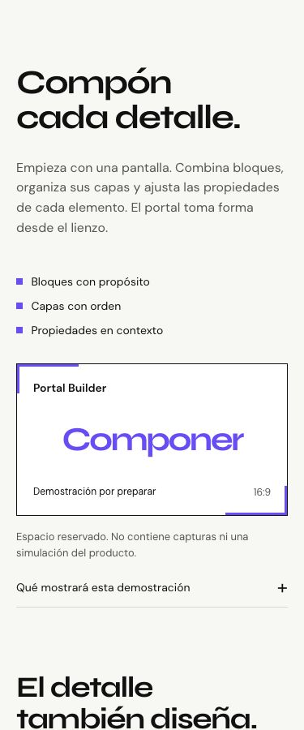

# NDL-WEB-003 — Product Storytelling & Experience Architecture

28 de octubre de 2026, America/Mexico_City. **GO para revisión local y preparación del storyboard. NO-GO para grabar, integrar medios o publicar automáticamente.**

La landing funcional ahora explica el producto desde composición hasta decisiones y control. Conserva la identidad visual, el Hero inmersivo y Living Interface de NDL-WEB-002. Cuatro espacios concretos definen qué grabar, qué afirmación permite sostener cada medio y cómo presentarlo de forma accesible. No se grabó video, se generaron capturas ficticias ni se incorporó el material privado de Starbucks.

## Rama y preservación

- Repositorio independiente: `Zuriel0/nodalume-web`.
- Baseline publicado `main`: `d4f833004cba3c24aa4a252fa075d6fca250617f`, confirmado por lectura remota; no actualizado.
- Base visual local NDL-WEB-002: `8d48a14b46c2e06bcc2c84c5aa654f5e7cfb6653`, rama original limpia al empezar y conservada.
- Rama sucesora local: `codex/ndl-web-003-product-storytelling`.
- Commit de implementación: `94e40c10a7a707583c0ec8bc8ab8d5ba8df18163`. Documentación y evidencia se entregan en un commit posterior de esta misma rama.
- ANXZU permaneció limpio en main; no se cambió su código, publicación o repositorio de producción. Nodalume no tiene cambios tracked derivados de esta revisión. No se modificó infraestructura, Pages, DNS o configuración de despliegue.
- Sin push, merge a main, tag ni release. El sitio público conserva NDL-WEB-001.

Vista previa: `http://127.0.0.1:4186/`. Para reproducir: `npm ci`, `npm run build`, `npm run preview`.

## Evidencia y narrativa

La [auditoría de capacidades](ndl-web-003-capabilities.md) revisa el producto actual en HEAD `0d5e0aa`, con Graphify como navegación y lectura de fuente como evidencia primaria. Hay bloques, capas, inspector contextual, tres vistas responsive, pantallas, conexiones por salida, condiciones, simulación y servicio de ejecución. Las dos últimas no deben seguir describiéndose como simple concepto, pero su presencia en código no acredita operación integral o conexión externa.

La sesión manual permitió contrastar `Prueba` en lectura: vistas escritorio/móvil, inspector presente y Lógica con ocho nodos y siete conexiones; vuelta a Diseño/Escritorio, Guardado y sin errores de chunks visibles. No se editaron propiedades ni se probaron guardado, publicación, restauración, simulación, APIs externas o acceso de red. No se capturó el producto. No se verificó de manera independiente el tenant/rol de esa sesión: ausencia de menú de plataforma no demuestra aislamiento.

La [arquitectura editorial y storyboard](ndl-web-003-storyboard.md) ordena:

1. Hero de libertad creativa y CTA al producto.
2. Problema concreto de la plantilla rígida sobre Ink.
3. Portal Builder: lienzo 16:9; contrapunto inspector 4:3 y plano responsive 9:16.
4. Design to Logic: pantalla, interacción, condición y dos resultados; relación conceptual identificada, sin ejecución simulada.
5. Control: borrador, publicación e historial; contexto de tenant con límites explícitos.
6. Living Interface conservada como exploración conceptual; mapa de evolución distingue implementación, integración por validar, concepto y futuro.
7. Cierre con enlace real al caso de ingeniería en ANXZU.

Se conserva blanco cálido, Syne/DM Sans, Ink, violeta y lima. Variaciones de escala y disposición sustituyen una sucesión de tarjetas uniformes. Todos los hashes anteriores siguen resolviendo; se añaden `#design-to-logic`, `#architecture` y cuatro `#demo-*`.

## Medios y movimiento

Cada espacio muestra su estado pendiente, una nota que niega ser captura/simulación y un desplegable nativo con función, alcance, formato/proporción/duración, alternativa textual, móvil y carga. No hay reproductor falso ni medio descargado. La propuesta de master de 50 segundos se apoya en cuatro segmentos: Builder 15–20 s, inspector 6–8 s, responsive 6–8 s y lógica 10–12 s. Requiere aprobación y fixture sin marcas ajenas antes de grabarse.

El [inventario de movimiento](ndl-web-003-motion.md) conserva el motor diferido GSAP. La entrada de la antigua película se sustituye por el dibujo de una sola conexión durante scroll. Las ramas condicionales permanecen estáticas. Seis triggers propios, igual que 002; tres ciclos verificaron 6→0→6. No se añade otro loop ni biblioteca. Las escenas nuevas son legibles sin animación. Reduced motion evita cargar GSAP; fallback 503 conserva los controles, texto y especificaciones.

## Comparación visual

Capturas reales de la landing, no de la app administrativa. Las escenas son extractos de captura completa, desde scroll inicial para evitar artefactos del header sticky. Se corrigió una captura preliminar móvil del baseline que había recortado un viewport de escritorio; las versiones entregadas usan el viewport correcto.

| Vista                    | Antes: NDL-WEB-002                                                | Después: NDL-WEB-003                                               |
| ------------------------ | ----------------------------------------------------------------- | ------------------------------------------------------------------ |
| Producto, 1440 px        | [Antes](evidence/ndl-web-003/screenshots/before-product-1440.jpg) | [Después](evidence/ndl-web-003/screenshots/after-product-1440.jpg) |
| Producto, 375 px         | [Antes](evidence/ndl-web-003/screenshots/before-product-375.jpg)  | [Después](evidence/ndl-web-003/screenshots/after-product-375.jpg)  |
| Página completa, 1440 px | [Antes](evidence/ndl-web-003/screenshots/before-full-1440.jpg)    | [Después](evidence/ndl-web-003/screenshots/after-full-1440.jpg)    |
| Página completa, 375 px  | [Antes](evidence/ndl-web-003/screenshots/before-full-375.jpg)     | [Después](evidence/ndl-web-003/screenshots/after-full-375.jpg)     |

Hay capturas del Hero EN/ES en 320, 375, 768, 1024, 1440 y 1920 px; de siete escenas a 375/1440; menú móvil y fallback. [Directorio de capturas](evidence/ndl-web-003/screenshots/).

## Rendimiento comparativo

Mismo lockfile, Node 24.19.0, Vite 8.3.5, Lighthouse 13.6.0 y Chrome 156. Baseline congelado en 4188 y candidato en 4186, ambos Vite preview. Tres corridas por perfil y versión, consecutivas, perfiles Chrome temporales sin autenticación, configuraciones oficiales móvil/escritorio con throttling simulado. Una corrida reduced adicional por versión. No hubo cambio de runtime entre mediciones finales y commit; [hashes de fuente](evidence/ndl-web-003/measured-source-sha256.json).

| Perfil     | Versión | Performance (3) | Accessibility (3) | LCP mediana / rango       | CLS / TBT |
| ---------- | ------- | --------------- | ----------------- | ------------------------- | --------- |
| Móvil      | 002     | 100 / 100 / 100 | 100 / 100 / 100   | 752.66 ms / 752.48–753.91 | 0 / 0 ms  |
| Móvil      | 003     | 100 / 100 / 100 | 100 / 100 / 100   | 752.62 ms / 752.42–753.73 | 0 / 0 ms  |
| Escritorio | 002     | 100 / 100 / 100 | 100 / 100 / 100   | 323.84 ms / 202.56–324.02 | 0 / 0 ms  |
| Escritorio | 003     | 100 / 100 / 100 | 100 / 100 / 100   | 202.58 ms / 202.55–203.25 | 0 / 0 ms  |

[Resumen comparativo](evidence/ndl-web-003/performance-comparison.json). JSON Lighthouse completos comprimidos en `evidence/ndl-web-003/lighthouse/{before,after}/`. Sin warnings en las 12 corridas normales. Los rangos se solapan: **no se declara mejora de velocidad**. Una serie exploratoria con servidor Python para el baseline produjo P móvil 97/100/100 y LCP de hasta 2107 ms; se excluye de la comparación por servidor no equivalente, no por su puntuación. Su resumen se conserva como `exploratory-python-summary.json`.

| Asset               | Bytes 002 | Bytes 003 | Gzip 002 | Gzip 003 |
| ------------------- | --------: | --------: | -------: | -------: |
| Entry React + EN/ES |   244,784 |   258,097 |   75,428 |   79,814 |
| Motion diferido     |   117,261 |   117,326 |   45,394 |   45,408 |
| CSS                 |    19,925 |    27,202 |    4,924 |    6,213 |
| JS normal total     |   362,045 |   375,423 |  120,822 |  125,222 |

[Hashes y tamaños](evidence/ndl-web-003/bundle-comparison.json). Gzip calculado de igual forma con Node zlib, no transferencia HTTP ni cálculo de Vite. Entry +13,313 bytes (contenido bilingüe, contratos audiovisuales y capítulos); CSS +7,277; motion +65. Sin dependencias nuevas, archivos de fuentes y marca sin cambios. GSAP sigue fuera del entry y se solicita durante carga normal; con reduced no se solicita. No hay React Flow ni código administrativo en el bundle del micrositio.

Estas mediciones describen carga de laboratorio sin videos. No son Web Vitals de campo ni prueba de fluidez de scroll. Dos gestos nativos cambiaron scrollY a 3994, sin pin spacers ni bloqueo, y dejaron ambiental pausado al salir del Hero. Sin profiler de FPS/CPU: no se declara 60 FPS ni consumo medido.

## Calidad y validaciones

- `npm ci`: correcto, 0 vulnerabilidades. Aviso npm por script opcional no aprobado de `fsevents@2.3.3`; no se concedieron permisos extra y no impidió lint/tests/build.
- `npm run lint`: correcto.
- `npm test` (`node --test tests/*.test.js`): **3/3**. Contrato EN/ES/hashes, pares AA y contratos completos de medios bilingües.
- `npm run build`: correcto; manifest generado; build posterior a npm ci conserva los mismos assets medidos.
- `git diff --check`: correcto.
- [Responsive](evidence/ndl-web-003/responsive.json): EN/ES × seis anchos, sin overflow ni texto esencial fuera del viewport; todos los hashes resuelven. Una [segunda pasada sobre el build final](evidence/ndl-web-003/final-responsive-expanded.json), con los cuatro contratos audiovisuales abiertos, confirmó ambas lenguas y los seis anchos sin IDs duplicados, hashes rotos ni desbordamiento.
- Teclado: menú Enter/Escape, foco de retorno y destino móvil; contrato audiovisual abierto con Enter; preset de Studio con Space y checkbox/reset operativos.
- Idioma sin recarga; hash conservado, preferencia persistida tras reload; contrato abierto y selección/conexiones de Studio conservados al traducir.
- [Pausa/reanudación](evidence/ndl-web-003/motion-cycles.json): tres ciclos sin acumulación de triggers; Studio transition 0s al pausar.
- Reduced Lighthouse: página completa, 0 triggers, sin petición de motion, control deshabilitado, Studio transition 0s.
- [Fallback forzado](evidence/ndl-web-003/fallback.json): 503 solo al chunk de motion; `static-fallback`, 0 triggers, preset/checkbox y especificaciones funcionan.
- Consola normal del micrositio: sin warnings/errores observados. El error intencional 503 se probó en pestaña separada.
- Enlace al caso técnico preservado en el cierre; no se modificó ANXZU. No hubo publicación ni peticiones de escritura al producto.

## Archivos y entrega

Runtime: `src/App.jsx`, `src/content.js`, `src/product-story.js`, `src/components/ProductStory.jsx`, `src/motion.js`, `src/styles.css`. Pruebas: `tests/content.test.js`. El archivo `LivingInterface.jsx` permanece idéntico al baseline.

Documentación: este reporte, `docs/ndl-web-003-capabilities.md`, `docs/ndl-web-003-storyboard.md`, `docs/ndl-web-003-motion.md`, `docs/ndl-web-003-design-plan.md`, `DESIGN.md`, `README.md`, apéndice en `docs/experience-map.md` y evidencias en `docs/evidence/ndl-web-003/`. `package.json`, lockfile, Vite y workflow Pages no se modifican.

## Límites y decisión

GO para revisar narrativa, composición y storyboard sobre la página local. La implementación mantiene las puntuaciones y aporta contratos de medios sin afirmar funcionamiento no demostrado.

Pendiente: aceptación integral del producto y sus integraciones; confirmar tenant/rol antes de grabar; fixture sin marcas ajenas; aprobación de storyboard y medios; pantalla táctil física, otros motores, lector de pantalla real y transición hidden/visible convencional (IAB no la reproduce de forma fiable); perfil de frames/CPU y validación con medios reales. Lighthouse Accessibility 100 no equivale a una auditoría WCAG completa. No se promete una fecha comercial ni despliegue cloud.

NO-GO para publicación o grabación automática. No hay autorización de despliegue en esta fase. Para volver a 002 basta cambiar a `codex/ndl-web-002-creative-evolution`; no se requiere revertir main ni tocar el sitio publicado.
