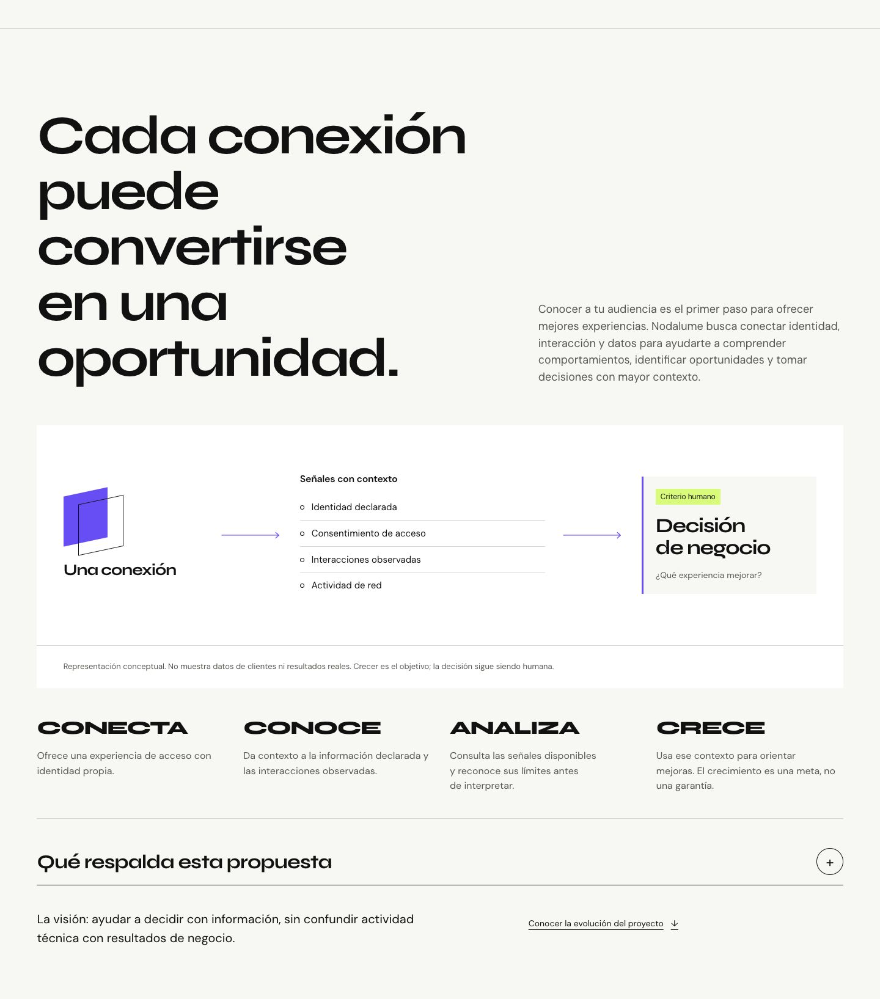

# NDL-WEB-004 — Data-Driven Growth + Git Synchronization

28 de octubre de 2026, America/Mexico_City. **GO para revisión en la rama consolidada de desarrollo. Sin merge a main, despliegue ni grabación.**

## Resultado editorial

La landing incorpora `#data-growth` entre Control y Living Interface, con el título propuesto y su equivalente inglés. Una conexión se relaciona con categorías de señales y termina en una pregunta para una decisión humana. CONECTA → CONOCE → ANALIZA → CRECE / CONNECT → UNDERSTAND → ANALYZE → GROW describe la intención del recorrido, sin afirmar crecimiento obtenido.

Se conservan Canvas, Surface, Ink, Electric y Signal; Syne y DM Sans. La escena alterna un título dominante, composición cualitativa, proceso de cuatro etapas y alcance desplegable. No hay dashboard inventado, porcentajes, predicciones, segmentaciones o datos numéricos que parezcan resultados del producto. La figura está identificada como conceptual. El texto distingue los hechos revisados de la visión comercial.

Portal Builder, Design to Logic, Control, Living Interface, Hero y sus destinos permanecen. El menú añade Datos y negocio / Data & growth. Se corrigió un problema observado de entrada directa: React podía montar el destino después de que el navegador resolviera el hash y dejar la página arriba. Ahora el idioma se aplica antes de resolver el hash inicial tras el commit de React; la navegación posterior conserva el scroll nativo. Se verificaron una entrada nueva a `#data-growth` en ES y una recarga a `#studio` con EN persistido, ambas a unos 120px del borde superior, bajo el header.

## Auditoría Git antes de editar

Se ejecutaron status, branch -vv, remote -v, log, fetch origin, comparación con origin/main e inventario de commits locales sin remoto en ambos repositorios.

| Proyecto     | Resultado                                                                                                                                                                                                         |
| ------------ | ----------------------------------------------------------------------------------------------------------------------------------------------------------------------------------------------------------------- |
| ANXZU        | main local = origin/main = `1ccd9e8d694052eb3191282e7794afa640e47895`; limpio; diferencia 0/0; ninguna rama local contiene commits fuera de las referencias remotas. No necesita merge, commit o push artificial. |
| Nodalume Web | Base visual `786743b35d0d759fafd04059e7a6ab5deaa3b896`; main publicado `d4f833004cba3c24aa4a252fa075d6fca250617f`. Cuatro commits locales de 002/003 aún no publicados, sin divergencia de main.                  |
| Continuación | Nueva rama `codex/ndl-web-004-data-growth`, descendiente directa de 003. Se mantienen los cuatro commits, documentación, capturas y métricas anteriores.                                                          |

[Auditoría Git](evidence/ndl-web-004/git-audit.json). No había cambios sin commit al empezar. Fuera de dependencias/build/skills generados, ANXZU solo tenía `.DS_Store` y `skills-lock.json` ignorados; Nodalume Web ninguno. No se encontraron rutas ignoradas de entorno, claves, auth state o credenciales en ese alcance. Se revisó además el contenido que se incorpora a Git con patrones de secretos; no se imprimieron valores sensibles. No se usó reset --hard, force push ni borrado de trabajo.

## Auditoría de capacidades de datos

Lectura del producto autorizado en HEAD `3253cfb5d62e015f7444c43358b5c7eca7b50322`. Graphify se usó como índice y el código como evidencia primaria. [Rutas y hashes](evidence/ndl-web-004/product-source-index.json). No se consultaron DB, perfiles, respuestas, tokens, cookies o registros de clientes; no se generaron reportes ni se ejecutaron servicios o pruebas del producto.

La clasificación es conservadora: **Parcial** identifica implementación encontrada cuyo funcionamiento integral no fue acreditado por esta revisión. No significa que el módulo esté ausente. No se asigna **Implementada y verificada** en sentido operativo completo a partir de una mera lectura de código. La figura es **Concepto** y el impacto empresarial es **Visión futura**, sin resultados garantizados.

| Capacidad                     | Clasificación | Evidencia encontrada                                                                                                                                 | Límite                                                                                                                                                              |
| ----------------------------- | ------------- | ---------------------------------------------------------------------------------------------------------------------------------------------------- | ------------------------------------------------------------------------------------------------------------------------------------------------------------------- |
| Captura de información        | Parcial       | `registrations/registration.service.js`, `registration-answers.js`: validación según formulario publicado y respuestas tipadas                       | Sin envío real ni aceptación UI/DB en esta fase; no todos los campos se capturan en todos los portales                                                              |
| Consentimiento                | Parcial       | Registro de versión/hash del aviso asociado al acceso                                                                                                | Consentimiento revisado para acceso de red; no acredita permiso de marketing ni cumplimiento legal integral                                                         |
| Identificación y sesiones     | Parcial       | Reportes de visitantes/accesos/sesiones y semántica de identidad conocida                                                                            | Email declarado no verificado; recurrencia técnica no equivale a personas únicas ni visitas físicas                                                                 |
| Accounting RADIUS             | Parcial       | `db/accounting-attribution.js`, fuentes de estadísticas y reportes basadas en radacct/radpostauth                                                    | No se probaron NAS/RADIUS ni correlación operativa; bytes, duración o aceptación no son compras                                                                     |
| Eventos e interacciones       | Parcial       | `portal-events` valida y persiste observaciones de carga, render/visibilidad de piezas, clic e inicio de formulario; enlace del envío desde servidor | Observación best effort y acotada al recorrido; dato ausente no demuestra ausencia de exposición o interés                                                          |
| Persistencia                  | Parcial       | Transacciones e INSERT de respuestas/eventos, asociación tenant/revisión/recorrido; consultas de reportes read-only                                  | SQL revisado, no ejecutado; sin prueba de durabilidad, recuperación, retención efectiva o calidad de datos                                                          |
| Analítica y visualizaciones   | Parcial       | Vistas Dispositivos, Consumo, Hábitos y Experiencia de acceso; consultas de distribución/cohortes/tiempos y reportes de campañas                     | Implementación real en código, no dashboard reproducido aquí. Datasets demo sintéticos separados; no ventas, retorno de inversión o modelos predictivos acreditados |
| Exportación e integraciones   | Parcial       | `campaign-analytics.service.js` y rutas: generación/lectura de reportes de campañas PDF, CSV y JSON                                                  | No se generó/descargó reporte ni se valida exportación general de toda la plataforma. No se anuncia sincronización CRM o automatización comercial                   |
| Separación entre tenants      | Parcial       | Tenant derivado de sesión, requireTenantAdmin, validación del scope y predicados tenant_id en repositorios                                           | No se probó aislamiento end-to-end, RLS ni una sesión concreta; no se garantiza segregación completa solo por el código                                             |
| Conexión → señales → decisión | Concepto      | Figura cualitativa del micrositio, sin datos reales                                                                                                  | Explica una relación posible, no evidencia una transferencia o procesamiento ejecutado                                                                              |
| Crecimiento empresarial       | Visión futura | Objetivo editorial de usar información para orientar mejoras                                                                                         | Sin impacto cuantificado, predicciones, garantía comercial ni fecha de entrega                                                                                      |

Las fuentes de reportes distinguen acceso emitido, aceptación RADIUS y Accounting-Stop, con semántica explícita que excluye ventas y visitas físicas. La landing conserva esa separación. No se publican el código privado, consultas completas, direcciones del laboratorio, nombres de tenants/personas ni secretos.

## Movimiento y accesibilidad

Se mantiene GSAP diferido. Una timeline con un ScrollTrigger adicional dibuja los dos tramos, ordena señales con x8→0 y opacidad .75→1 y ajusta la decisión de escala .97→1. No hay loop nuevo, pinning, scroll hijacking ni un RAF por conexión. Total: siete triggers frente a seis en 003.

La secuencia pertenece al contexto GSAP ya existente y aprovecha su cleanup, suspensión de visibilidad y control manual. Las etiquetas de señales mantienen sus nodos DOM al traducir para no dejar la animación apuntando a nodos retirados. Tres ciclos verificaron 7→0→7; al pausar no quedan transforms inline en señales. Reduced motion deja toda la composición estática sin solicitar el chunk de GSAP. El fallback 503 conserva señales, alcance y Living Interface.

La figura tiene orden de lectura y figcaption; sus líneas y planos son decorativos. Las etapas usan una lista ordenada y el alcance `details/summary` nativo. El menú móvil conserva foco de destino, cierre y teclado. El color no es la única señal de información. Los textos distinguen observaciones, interpretación humana y objetivo.

## Validaciones

- `npm ci`: correcto, 0 vulnerabilidades; aviso opcional de fsevents no aprobado, sin conceder permisos extra.
- `npm run lint`: correcto.
- `npm test`: **4/4** (contenido EN/ES, contraste AA, contratos de medios y nueva narrativa bilingüe).
- `npm run build`: correcto, manifest generado.
- `git diff --check`: correcto.
- [EN/ES × 320, 375, 768, 1024, 1440 y 1920px](evidence/ndl-web-004/responsive.json): alcance abierto, cinco enlaces de navegación, sin overflow, contenido esencial fuera de pantalla, hashes rotos o IDs duplicados.
- Menú móvil activado por Enter, destino `#data-growth` con foco y cierre; alcance abierto por Enter; cambio de idioma conserva hash y apertura. Living Interface y las escenas anteriores siguen presentes y operativas; el fallback permitió cambiar su preset.
- [Tres ciclos de pausa](evidence/ndl-web-004/motion-cycles.json), [fallback](evidence/ndl-web-004/fallback.json) y [entradas directas](evidence/ndl-web-004/direct-hashes.json).
- [Scroll nativo](evidence/ndl-web-004/scroll.json): 8005→9005px; offsets de los dos trazos 91/130→0/0px, ambiental del Hero pausado y cero pin spacers. Consola normal sin warnings/errores observados; fallo 503 intencional en pestaña separada.
- ANXZU se clonó **anónimamente desde GitHub** en una carpeta temporal y pasó npm ci, lint, pruebas y build. [Comprobante](evidence/ndl-web-004/anxzu-clone-check.json). No se modificó su checkout original.

## Métricas

Lighthouse 13.6.0, Chrome 156, Node 24.19.0, Vite preview local del build final. Tres corridas por perfil en Chrome temporal sin sesión y una corrida adicional reduced. [JSON originales comprimidos y resumen](evidence/ndl-web-004/lighthouse/summary.json).

| Perfil                 | Performance     | Accessibility   | LCP mediana / rango         | CLS / TBT |
| ---------------------- | --------------- | --------------- | --------------------------- | --------- |
| Móvil, 3 corridas      | 100 / 100 / 100 | 100 / 100 / 100 | 752.59ms / 752.18–1361.91ms | 0 / 0ms   |
| Escritorio, 3 corridas | 100 / 100 / 100 | 100 / 100 / 100 | 202.82ms / 202.42–323.60ms  | 0 / 0ms   |

Sin warnings en las seis corridas finales. Reduced: cero triggers, sin petición de motion, Studio transition 0s. Son mediciones de carga, no Web Vitals de campo ni FPS. No se midió CPU/fluidez con un profiler. No se declara mejora de velocidad respecto a 003; su puntuación 100/100 es una referencia histórica, no un experimento contemporáneo de mejora.

| Asset  | Bytes 003 | Bytes 004 | Gzip 003 | Gzip 004 |
| ------ | --------: | --------: | -------: | -------: |
| Entry  |   258,097 |   265,404 |   79,814 |   82,076 |
| Motion |   117,326 |   117,909 |   45,408 |   45,539 |
| CSS    |    27,202 |    32,580 |    6,213 |    7,023 |

[Comparación de assets](evidence/ndl-web-004/bundles.json), gzip calculado por Node zlib, no transferencia HTTP. JS normal total 375,423→383,313 bytes; el entry crece 7,307 por contenido bilingüe, escena y corrección de hash. Sin dependencias nuevas; package/lockfile, fuentes, marca y workflow de Pages sin cambios. No se incorporan React Flow ni módulos administrativos al micrositio.

## Evidencia visual

Doce capturas completas de la sección, una por idioma/ancho. Se hicieron con **pausa manual** para mostrar la composición estática íntegra; no prueban por sí solas el movimiento. [Inventario](evidence/ndl-web-004/captures.json). No se grabaron videos ni se abrió el medio privado de Starbucks.

[Vista móvil ES](evidence/ndl-web-004/screenshots/growth-es-375.jpg) · [Vista móvil EN](evidence/ndl-web-004/screenshots/growth-en-375.jpg) · [Todas las capturas](evidence/ndl-web-004/screenshots/)

## Sincronización y siguiente computadora

Rama consolidada autorizada: [codex/ndl-web-004-data-growth](https://github.com/Zuriel0/nodalume-web/tree/codex/ndl-web-004-data-growth). La publicación Git de esta rama conserva los cuatro commits previos como ancestros: `de5eaca`, `8d48a14`, `94e40c1`, `786743b`. Sus ramas locales originales permanecen disponibles. No se crea un merge innecesario ni se cambia main.

El SHA final se entrega en el cierre de la fase. La comprobación remota/clonación se añade al final de este reporte después del primer push validado. La rama no dispara Pages: el workflow solo escucha main y ambos jobs requieren `refs/heads/main`.

[Comandos exactos para clonar y ejecutar ambos proyectos](clone-and-run.md). Es importante clonar la rama consolidada de Nodalume Web: una clonación de main obtiene únicamente el baseline publicado.

## Archivos y límites

Runtime: `src/components/DataGrowth.jsx`, `src/data-growth.js`, integración/entrada inicial en `src/App.jsx`, navegación en `src/content.js`, `src/motion.js`, `src/styles.css`; pruebas en `tests/content.test.js`. Documentación: este reporte, plan 004, `docs/clone-and-run.md`, README, DESIGN y evidencia 004. ProductStory, LivingInterface y sus datos no cambian.

Pendiente: validar funciones de datos con pruebas integrales y muestras autorizadas; autorización específica para futuros medios; revisión comercial de la narrativa; dispositivos físicos/otros motores/lector de pantalla y transición hidden/visible real, que IAB no reproduce de forma fiable. No se convierte Accessibility 100 en certificación WCAG.

GO para sincronizar/revisar la rama de desarrollo. No se modifican aplicación administrativa, laboratorio, ANXZU, DNS o Pages. No hay merge a main de Nodalume Web, grabación, release ni despliegue automático.
