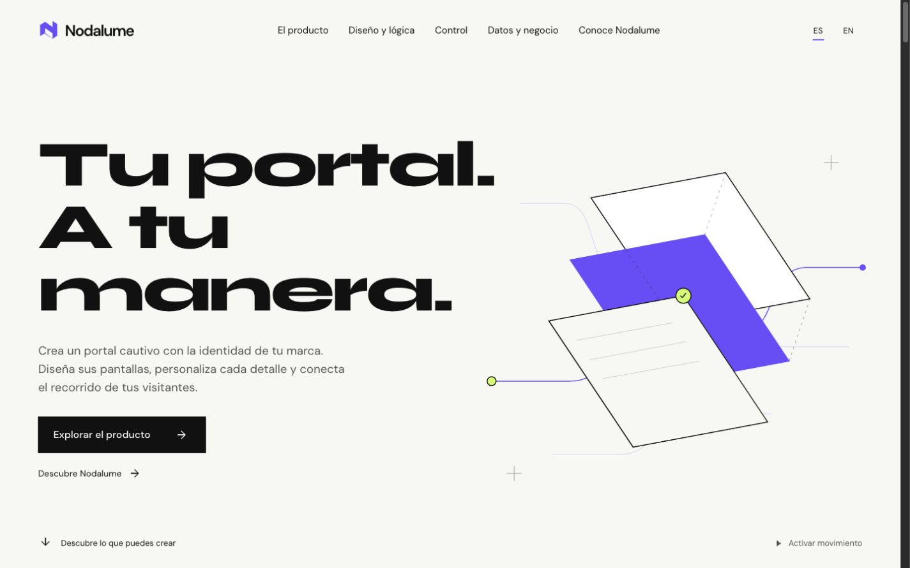
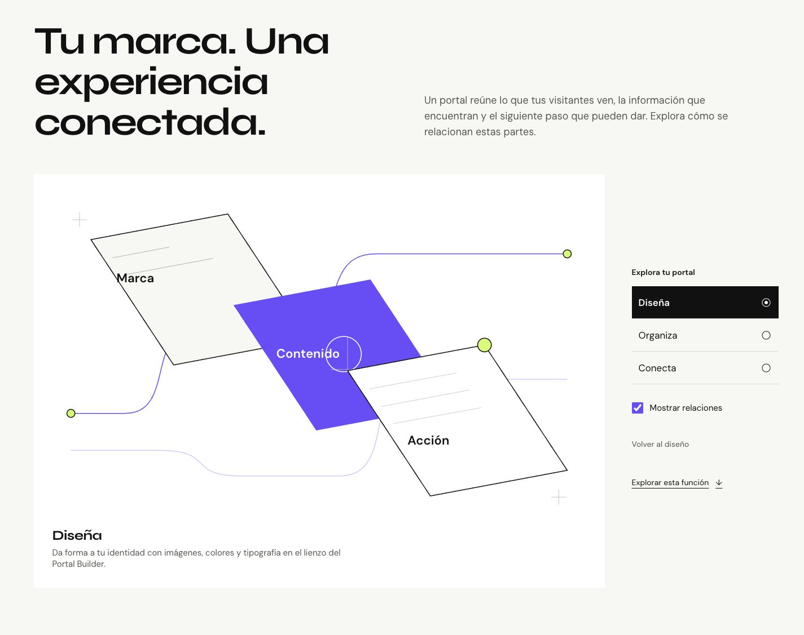
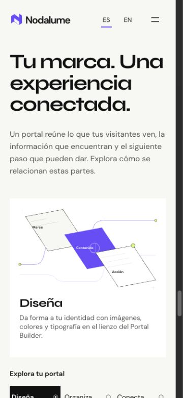

# NDL-WEB-005 — Revisión comercial y publicación

Fecha: 2026-11-07, America/Mexico_City. Continuación de `codex/ndl-web-004-data-growth` en `codex/ndl-web-005-commercial-review`. Base de desarrollo `42005ab`; baseline público anterior `d4f8330`. El propietario solicita explícitamente push y publicación. La autorización adicional identifica los tres medios y el destino público.

## Decisión editorial

La landing se dirige a quien evalúa un portal para su marca. Se conserva el diseño Creative Systems, sus fuentes, paleta, composición y animación. Cambia el discurso: identidad → construcción visual → recorrido → gestión de cambios → información útil → partes del portal → preguntas frecuentes → contacto.

- Eliminadas «composición de posibilidades», «exploración visual», notas de auditoría y placeholders de demostraciones.
- Eliminados «Acerca de esta demostración», formatos, duración editorial y «grabación real del editor» de la interfaz. La duración que muestra el reproductor nativo sigue siendo un control útil.
- Textos ES/EN revisados desde el punto de vista del visitante. Título y descripción de página localizados.
- Living Interface explica Marca / Contenido / Acción con Diseña / Organiza / Conecta, descripción y enlace a la función correspondiente. Conserva sus estados, teclado, reset, conexiones y reduced motion. Es un diagrama explicativo; no representa una sesión del editor ni ejecuta flujos.
- El antiguo mapa de auditoría se convierte en preguntas frecuentes de producto, conservando sus hashes.
- CTA principal de cierre: «Hablemos de tu portal», con destino real `https://anxzu.com/#contact`. Caso técnico como enlace secundario.
- Se conserva «En desarrollo» y se explican los límites de integraciones y operación donde afectan a quien evalúa el producto. No se anuncian métricas comerciales, SLA, contratación ni funciones nuevas.

## Medios aprobados

El propietario autorizó expresamente publicar los siguientes MP4 y su contenido de BRIAVÉ CAFÉ tanto en `nodalume.anxzu.com` como en `Zuriel0/nodalume-web`:

| Origen del propietario | Destino público | Tamaño |
|---|---|---:|
| Portal_Builder.mov | /media/portal-builder.mp4 | 1,585,078 bytes |
| Inspector.mov | /media/inspector.mp4 | 595,242 bytes |
| RESPONSIVE.mov | /media/responsive.mp4 | 835,383 bytes |

Total MP4 público: 3,015,703 bytes. Conversión previa con FFmpeg 7.1 / libx264 CRF 24, 30 fps, faststart y sin audio. Posters WebP extraídos de las grabaciones. Encuadre original conservado; Responsive mantiene 468×902, los otros 1920×1080. Originales intactos; decodificación completa validada durante la conversión.

Logic Builder con Starbucks continúa privado e ignorado. No se copió su video ni poster a public/dist. Su espacio público conserva el diagrama y la explicación de decisiones. Una prueba de allowlist impide añadir otros medios públicos accidentalmente.

Carga a petición (`preload=none`), sin autoplay, con controles nativos. Posters al entrar en viewport, dimensiones reservadas, pausa fuera de vista y cuando la página se oculta, reproducción exclusiva y cleanup. En caso de error, poster y explicación textual. Reduced motion y pausa global no inician medios; el usuario conserva el control manual. No se incorporaron dependencias.

## Verificación previa a publicación

- `npm run lint`, `npm test` (5/5), `npm run build`, `git diff --check`: correctos.
- Revisión en 320, 375, 768, 1024, 1440 y 1920 px: sin overflow horizontal; proporciones de los tres medios conservadas.
- Reproducción real de los tres MP4: readyState 4, avance temporal y sin errores de medios.
- Pausa al pasar a otro video o salir de viewport comprobada. No se midió el cambio real de visibilidad de pestaña en esta revisión; listener y cleanup conservados.
- EN/ES sin recarga, estado del bloque interactivo conservado y texto de enlace correcto. Sin notas editoriales antiguas en el DOM visible.
- Menú móvil: Escape cierra y devuelve foco. Activación de presets mediante teclado comprobada; hashes de todos los enlaces internos resuelven.
- Pausa global y composición estática comprobadas. Reduced motion se revisó en fuente/CSS; no se cambió la preferencia del sistema operativo.
- Consola inspeccionada sin errores ni avisos.
- Build contiene exclusivamente tres MP4 y tres WebP aprobados. Sin MOV, Logic Builder, auth state ni credenciales.

JS inicial previo de revisión local: 270.26 kB; revisión comercial: aproximadamente 259.02 kB. Motion permanece en chunk diferido de 117.90 kB. Esto describe assets, no Web Vitals. No se repitió Lighthouse ni se afirman mejoras de LCP, CLS o FPS en esta tarea.

## Evidencia

## Alcance y salida

GO para integrar y publicar la revisión comercial mediante el workflow existente de GitHub Pages desde main. Sin DNS, infraestructura, administración de Nodalume ni ANXZU modificados. No se graban videos. El push conserva los commits de las fases anteriores. Se mantiene la directiva previa `noindex, nofollow`; la decisión de indexación es independiente de este despliegue.

El resultado del despliegue debe contrastarse con el commit publicado y la carga real del dominio; el éxito del build local por sí solo no acredita publicación.
